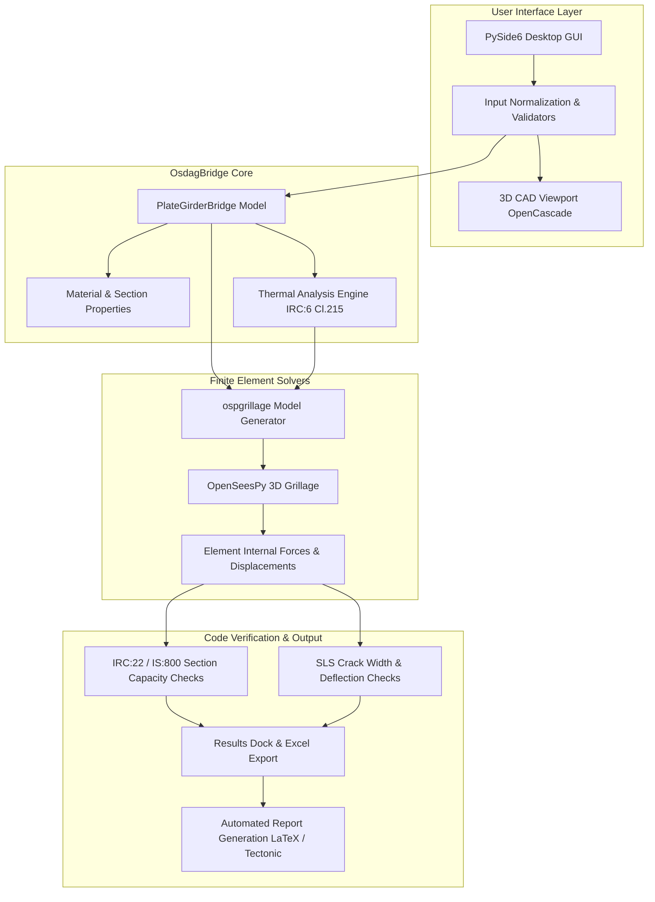
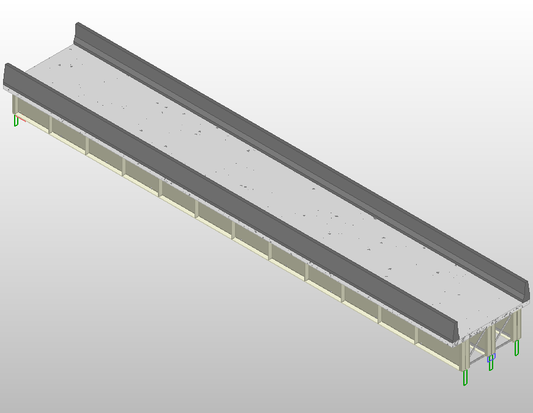
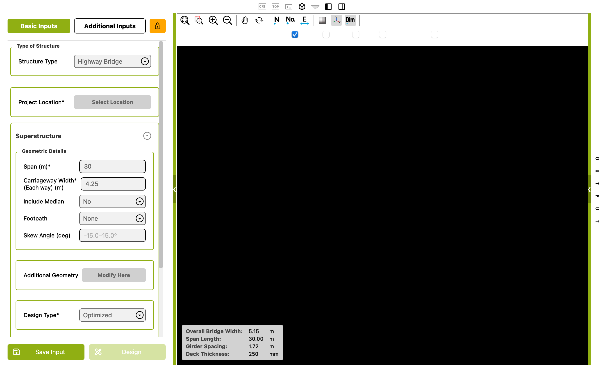
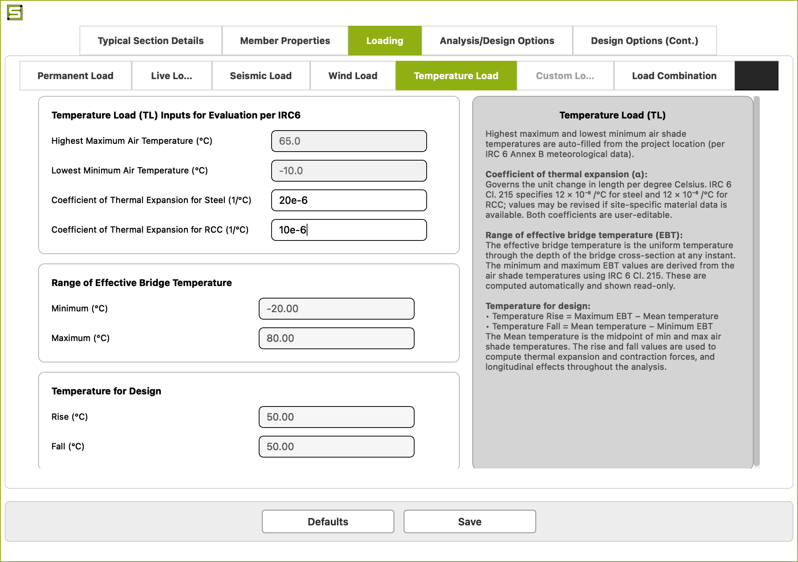
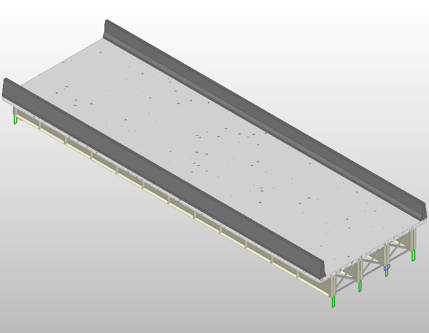
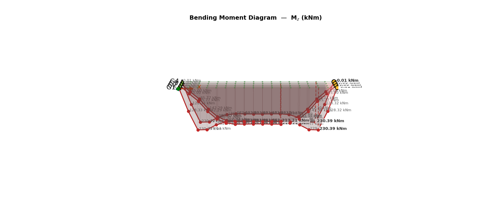
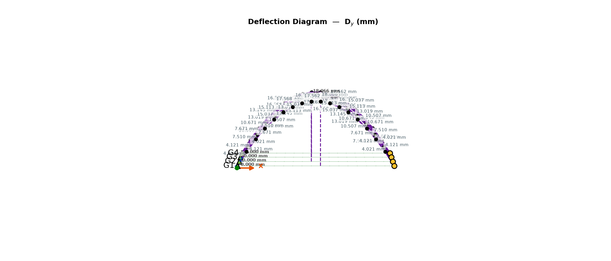

# OsdagBridge — FOSSEE IIT Bombay Winter Internship 2026 Screening Submission

[](https://fossee.in/)
[](https://www.python.org/)
[](https://www.qt.io/)
[](https://dev.opencascade.org/)
[](https://openseespydoc.readthedocs.io/)
[](LICENSE)

Comprehensive software quality assurance, defect investigation, candidate resolution, and structural thermal grillage implementation for **OsdagBridge** as part of the screening evaluation for the **FOSSEE IIT Bombay Winter Internship 2026**.

Candidate Author: **Rohan Siddhpura**  
Repository: [https://github.com/rohansiddhpura17-source/OsdagBridge](https://github.com/rohansiddhpura17-source/OsdagBridge)  
Upstream Reference: [https://github.com/Nidhikhare12/OsdagBridge](https://github.com/Nidhikhare12/OsdagBridge)  
Baseline Anchor Commit: [`d74f56dd7f22925fb8148cabf5740ed8d1e39ff3`](https://github.com/Nidhikhare12/OsdagBridge/commit/d74f56dd7f22925fb8148cabf5740ed8d1e39ff3)  
Candidate Branch: `phase20-thermal-issue92`

---

## Executive Summary & Verified Project Statistics

| Verified Engineering Metric | Value / Status | Description |
|---|---|---|
| **Original Test Catalog Executed** | **51 / 51** | 35 baseline PASS, 16 baseline FAIL, 0 NOT RUN, 0 BLOCKED |
| **Confirmed Defect Findings** | **24 Fixed** | BUG-01..16, BUG-24, UPSTREAM-92 (Scoped), BUG-25..30 |
| **Resolved Non-Defects** | **1 Resolved** | REF-01 (Standard-OSI load restoration SHA-256 match confirmed) |
| **Historical Unit Regressions** | **28 / 28 PASS** | Current-worktree unit regression suite (`pytest tests/unit`) |
| **Conda Refinement Regressions** | **6 / 6 PASS** | Phase 19/20 fixes under Conda Python 3.12 (`test_phase20_bug25_to_30_conda.py`) |
| **Live GUI Workflow Assertions** | **29 / 29 PASS** | 15 revalidation + 7 BUG-14/ADV-003 + 7 Issue #92 workflow |
| **Historical Thermal Benchmarks**| **75 / 75 PASS** | Phase 17 standalone finite element prototype benchmarks |
| **New Analytical Thermal Oracles**| **15 / 15 PASS** | BM-01..15 OpenSeesPy IRC:6 Cl. 215 closed-form benchmarks (Rel. Err $\le 7.62\times 10^{-8}$) |
| **192-Element Superposition Oracle**| **0 Mismatch** | Full load oracle verified across 2,304 force cells and 648 displacement cells |
| **Modified Source Files in Patch** | **34 Files** | Combined patch `phase20_combined_all_fixes.patch` (231 KB) |
| **Candidate Scope for Issue #92** | **Scoped Fix** | Single-span composite plate-girder bridges, $\|\text{skew}\| \le 15^\circ$ |

---

## Project Overview

**OsdagBridge** is an open-source bridge analysis and design module developed under the Osdag structural engineering ecosystem (FOSSEE, IIT Bombay). It couples high-level bridge geometry modeling with 3D CAD visualization (OpenCascade / pythonocc-core), automated finite-element grillage mesh generation (`ospgrillage`), finite-element structural solving (`OpenSeesPy`), design code checking (IRC:22, IRC:24, IRC:6, IS 800), and automated LaTeX/PDF design report generation.

### Screening Objectives
1. **Systematic Software Quality Assurance**: Execute the complete 51-case screening catalog across geometry, materials, stiffeners, load combinations, boundary conditions, CAD generation, and reports.
2. **Defect Root-Cause Analysis**: Locate, reproduce, and isolate defects across all architectural layers.
3. **Candidate Resolution & Invariance**: Implement minimal, non-regressive candidate fixes while ensuring that valid baseline non-thermal designs remain 100% numerically unaffected.
4. **Thermal Analysis Resolution (Upstream Issue #92)**: Resolve upstream issue [#92](https://github.com/Nidhikhare12/OsdagBridge/issues/92) by implementing physically correct thermal expansion, contraction, and nonlinear vertical temperature gradient actions per **IRC:6-2017 Clause 215**, replacing the invalid legacy vertical pressure substitute.

---

## Software Testing Methodology & Architecture

Testing enforces a rigorous **Three-Track Architecture**:
1. **Track 1: Untouched Baseline (`d74f56dd7f`)**: Serves as the immutable reference oracle. All 51 screening cases were genuinely executed on the baseline; failing test cases document legitimate defect exposure rather than being suppressed.
2. **Track 2: Candidate Core (BUG-01..16, BUG-24..30)**: Resolves 23 core application defects spanning SLS deck crack calculations, material property units, boundary coordinate validation, CAD viewport redraws, longtable LaTeX syntax, BOQ volumes, and load combination factors.
3. **Track 3: Scoped Thermal Analysis (Issue #92)**: Implements IRC:6-2017 Cl. 215 composite bridge thermal action inside OpenSeesPy and `ospgrillage` within a verified structural scope.



---

## Technologies Used

- **Programming Language**: Python 3.12 (Conda runtime environment)
- **GUI Framework**: PySide6 6.7+ (Qt6, Cocoa QPA on macOS)
- **CAD Kernel**: OpenCASCADE / pythonocc-core (native AIS interactive context)
- **Finite Element Solver**: OpenSeesPy (3D beam-column & zeroLength spring elements)
- **Grillage Pre-processor**: ospgrillage (customized with `ThermalElementLoad`)
- **Numerical Libraries**: NumPy, SciPy, Pandas, Xarray
- **Testing Frameworks**: PyTest, custom live Qt GUI event-driven test harnesses
- **Documentation & PDF**: ReportLab 5.1.0, PyPDF 6.21.4, Tectonic / XeLaTeX

---

## Installation & Environment Setup

### 1. Prerequisites
- macOS, Linux, or Windows with Conda (Miniconda or Miniforge)
- OpenGL-capable display driver for OpenCascade 3D rendering

### 2. Clone Repository
```bash
git clone https://github.com/rohansiddhpura17-source/OsdagBridge.git
cd OsdagBridge
git checkout phase20-thermal-issue92
```

### 3. Create Conda Environment
```bash
conda env create -f environment.yml
conda activate osdagbridge
```

Alternatively, install key runtime dependencies into an existing Python 3.12 environment:
```bash
pip install -e .
pip install pytest reportlab pypdf numpy scipy pandas xarray
```

---

## Instructions to Run the Application & Regression Tests

### Launch Desktop Application
```bash
python -m osdagbridge.desktop
```

### Run Unit Regression Suites
```bash
# Run all unit tests
pytest -q tests/unit

# Run Conda refinements regression suite (BUG-25..30)
pytest -q tests/phase20/test_phase20_bug25_to_30_conda.py

# Run Issue #92 analytical benchmarks (BM-01..15)
pytest -q tests/phase20/test_phase20_thermal_issue92.py
```

### Run Live GUI Verification Suites (Requires Graphical Display)
```bash
# Verify Issue #92 live GUI workflow and temperature loading subtab
python scripts/run_phase20_issue92_gui_workflow.py

# Verify BUG-14 / ADV-003 Optimized <-> Custom mode switching
python scripts/run_phase20_bug14_adv003_gui.py

# Revalidate all 17 initial fixes in live GUI
python scripts/run_phase20_17fix_gui_revalidation.py
```

---

## Complete Defect Summary (All 24 Resolved Defects)

| Defect ID | Severity | Upstream Reference | Root Cause Location | Defect Description & Candidate Resolution Summary |
|---|---|---|---|---|
| **BUG-01** | CRITICAL | [#148](https://github.com/Nidhikhare12/OsdagBridge/issues/148) | `plategirderbridge.py:3186` | Concrete $E_{cm}$ passed in GPa (33.0) to deck design expecting MPa. Modular ratio distorted $1000\times$ ($6060.61 \to 6.06$). Exposes true crack width failure ($w_k = 0.3524 > 0.30\text{ mm}$). |
| **BUG-02** | HIGH | [#148](https://github.com/Nidhikhare12/OsdagBridge/issues/148), [#41](https://github.com/Nidhikhare12/OsdagBridge/issues/41) | `generate_results_values_builder.py:215` | Concrete Results Table & Excel export reported 33 GPa under MPa header; hardcoded 25.0 density. Corrected units and dynamic density. |
| **BUG-03** | HIGH | [#41](https://github.com/Nidhikhare12/OsdagBridge/issues/41) | `plategirderbridge.py:1333` | Custom concrete density omitted from `model.create_deck_load()`, defaulting to 25.0. Corrected to pass user density dynamically. |
| **BUG-04** | HIGH | [#20](https://github.com/Nidhikhare12/OsdagBridge/issues/20) | `analyser.py:371,416` | Custom girder steel density ignored; hardcoded $78.5\text{ kN/m}^3$. Self-weight load case now accurately scales with user density. |
| **BUG-05** | MEDIUM | [#118](https://github.com/Nidhikhare12/OsdagBridge/issues/118) | `material_properties.py:137` | Steel shear modulus $G$ truncated to 1 decimal place ($76.923 \to 76.9\text{ GPa}$). Validator precision extended to 3 decimal places. |
| **BUG-06** | HIGH | [#43](https://github.com/Nidhikhare12/OsdagBridge/issues/43) | `crossbracingforces.py:565` | Cross-bracing and end-diaphragm designs ignored selected/custom steel grades. Corrected property inheritance. |
| **BUG-07** | HIGH | [#130](https://github.com/Nidhikhare12/OsdagBridge/issues/130) | `validator.py:1094` | Validators and OSI loaders accepted non-finite numbers (`NaN`, `Inf`, `1e999`). Added strict finite float guards. |
| **BUG-08** | MEDIUM | [#125](https://github.com/Nidhikhare12/OsdagBridge/issues/125) | `input_dock.py:1002` | 66 stale optimized section and stiffener keys persisted after same-instance redesign ($30 \to 32 \to 30\text{ m}$). State cleanup added. |
| **BUG-09** | MEDIUM | [#125](https://github.com/Nidhikhare12/OsdagBridge/issues/125) | `additional_inputs.py:237` | 119 stale dynamic G4 keys persisted after changing girder count from 4 to 3. Dynamic dictionary pruning implemented. |
| **BUG-10** | MEDIUM | [#85](https://github.com/Nidhikhare12/OsdagBridge/issues/85) | `cad_3d.py:194` | 3D CAD viewport rendered black after same-instance redesign. Direct OpenCascade AIS context refresh implemented. |
| **BUG-11** | HIGH | New (#121 distinct) | `chap2.py`, `chap3.py`, `chap4.py`, `chap5.py` | Misplaced `\noalign` across 47 captioned longtables crashed LaTeX report compilation. Corrected caption table grammar. |
| **BUG-12** | MEDIUM | [#19](https://github.com/Nidhikhare12/OsdagBridge/issues/19) | `input_dock.py:323` | Loading custom material OSI then running `_prime_material_inputs()` crashed girder and wiped deck properties. Safe priming added. |
| **BUG-13** | HIGH | [#113](https://github.com/Nidhikhare12/OsdagBridge/issues/113) | `plategirderbridge.py:2296` | Omitted `edge_dist`, shifted G2..G(n+1) naming, and blind `[1:-1]` slicing scrambled girder mapping. Restored geometry consistency. |
| **BUG-14** | HIGH | New (#125 related) | `defaults.py:170`, `input_dock.py:676` | Optimized $\leftrightarrow$ Custom switching injected $\text{mm}^2$ into $\text{m}^2$ fields, clobbered railing, and retained stale stiffeners. Unit handling isolated. |
| **REF-01** | NON-DEFECT | — | N/A | Standard-OSI load restoration observation. Verified exact SHA-256 match between original and reloaded OSI files. |
| **BUG-15** | CRITICAL | New | `ospgrillage/load.py:435`, `osp_grillage.py:2152` | Baseline `ospgrillage` omitted load combination factors when emitting OpenSees load commands. Added factoring in load generation. |
| **BUG-16** | MEDIUM | [#65](https://github.com/Nidhikhare12/OsdagBridge/issues/65) | `executive_summary.py:77` | Executive summary hardcoded component passes and omitted non-girder failures. Dynamic evaluation implemented. |
| **BUG-24** | HIGH | New | `generate_results_values_builder.py:1682` | Shear connector spacing table displayed PASS when provided spacing exceeded maximum limit ($s_{\text{prov}} > s_{\max}$). |
| **UPSTREAM-92**| CRITICAL | [#92](https://github.com/Nidhikhare12/OsdagBridge/issues/92) | `plategirderbridge.py:1858`, `common.py:819` | Canonical thermal inputs ignored; legacy vertical pressure substitute used. Implemented IRC:6 Cl. 215 thermal engine. |
| **BUG-25** | MEDIUM | New | `is800_2007.py:209`, `irc22_2015.py:334` | Case-sensitive `section_type == 'Rolled'` check downgraded default 'rolled' compression flanges to Welded limits. Made case-insensitive. |
| **BUG-26** | HIGH | New | `designer.py:1320` | `compute_fatigue()` multiplied IRC:22 Cl. 605.4 shear limit $\tau_y$ ($107.5\text{ MPa}$) by $1.5$ to $161.25\text{ MPa}$. Corrected to $107.5\text{ MPa}$. |
| **BUG-27** | HIGH | New | `deckdesign.py:849` | Utilization helper `_ur(demand, 0)` returned $0.0$ (false PASS) on zero capacity. Corrected to return $9.999$ (explicit failure). |
| **BUG-28** | MEDIUM | New | `boq_generator.py:120` | BOQ hardcoded densities, computed girder volume from G1 only, and used diagonal area for bracing chords. Corrected volume integration. |
| **BUG-29** | HIGH | New | `analysis_results.py:1382` | `_get_girder_sw_df()` fabricated $22.4\text{ kN/m}$ ($672.0\text{ kN}$) on Z-key miss. Corrected to compute actual geometry or default to $0.0$. |
| **BUG-30** | MEDIUM | New | `validator.py:978`, `cad_generator.py:1105` | `validate_map_coordinates` accepted `NaN`/`Inf`; mutable default `label=[]` caused shared-list crashes. Added float bounds and `None` default. |

---

## Thermal Solver Implementation (Upstream Issue #92)

### Standards Compliance: IRC:6-2017 Clause 215
1. **Effective Bridge Temperatures**: Metallic bridge equations translate shade air temperatures ($T_{\max}, T_{\min}$) into effective bridge temperatures:
   $$T_{e,\min} = -20 + 0.64(T_{\min} + 20), \quad T_{e,\max} = 10 + 0.90(T_{\max} - 10)$$
2. **Uniform Temperature Actions**: Reference bridge-setting band $T_0$ is centered about mean air temperature ($T_{0,\min/\max} = T_{\text{mean}} \pm 10\text{ K}$). Uniform rise is $\Delta T_{\text{rise}} = T_{e,\max} - T_{0,\min}$ and fall is $\Delta T_{\text{fall}} = T_{0,\max} - T_{e,\min}$.
3. **Nonlinear Vertical Temperature Gradients (Cl. 215.4)**: Composite sections undergo layered numerical integration across $N$ horizontal strips. Restrained axial forces and bending moments are recovered by:
   $$N_{\text{th}} = \sum_{i=1}^N E_i \alpha_i \Delta T(y_i) A_i, \quad M_{\text{th}} = \sum_{i=1}^N E_i \alpha_i \Delta T(y_i) A_i (y_i - y_{\text{NA}})$$
   Strip self-inertia terms ($\sum E_i \kappa w_i h_i^3 / 12$) maintain exact equilibrium balance ($|\sum M| = 1.86 \times 10^{-9}\text{ Nm}$ in benchmark BM-10).
4. **Finite Element Modeling**:
   - Equivalent nodal load vectors $[-N_{\text{th}}, 0, M_{\text{th}}, N_{\text{th}}, 0, -M_{\text{th}}]$ are injected into `ospgrillage` using `ThermalElementLoad`.
   - Transformed composite section properties are used for thermal load cases, while preserving bare-steel self-weight dead load.
   - Explicit `zeroLength` longitudinal bearing springs ($k_x = 10^7\text{ N/m}$) capture bearing restraint and support forces.
5. **Superposition & Enveloping**:
   - Opposing thermal actions (`TL_UNIFORM_RISE` vs `TL_UNIFORM_FALL`, and `TL_GRADIENT_HEAT` vs `TL_GRADIENT_COOL`) are modeled as separate load cases.
   - Governing envelope `1.0 TL` is combined into ULS and SLS combinations per IRC:6 Table B.2/B.3.
6. **Nonthermal Model Invariance (Case D)**:
   - For non-thermal bridge models, composite stiffness substitution is bypassed, zero thermal cases are emitted, and bare-steel sections are used, ensuring 100% numerical invariance with baseline non-thermal analyses.

---

## Visual Verification Evidence

### 1. 3D CAD Viewport Capture (Direct OpenCascade vs QWidget Grab)
Direct OpenCascade `View.Dump` captures 100% of rendered AIS objects, bypassing macOS Cocoa OpenGL grab limitations:

| Direct OpenCascade `View.Dump` (PASS) | Standard QWidget Grab (macOS OpenGL Blanking) |
|:---:|:---:|
|  |  |

### 2. Live GUI Temperature Load Input & 3D Redesign Viewport
| Live GUI: Temperature Load Subtab (65/−10 °C) | OpenCascade 3D CAD Dump After Redesign |
|:---:|:---:|
|  |  |

### 3. Thermal Structural Analysis Diagrams (1.0 TL Governing Load Case)
| 1.0 TL Bending Moment Diagram ($M_z = 230.39\text{ kNm}$) | 1.0 TL Vertical Deflection Diagram ($d_y = 18.07\text{ mm}$) |
|:---:|:---:|
|  |  |

---

## Known Limitations & Verified Engineering Scope

1. **Issue #92 Scope Boundary**:
   - **Supported & Candidate-Fixed**: Single-span composite plate-girder bridges with absolute skew not exceeding 15 degrees ($|\text{skew}| \le 15^\circ$) under IRC:6-2017 Cl. 215.
   - **Explicitly Out of Scope**: Continuous multi-span bridges, curved alignments, and transverse thermal expansion across multi-bearing piers.
   - **Fail-Closed Protection**: Inputting skew $> 15^\circ$ or passing legacy pressure values raises an informative `ValueError`.
2. **Crack Width Compliance**:
   - Correction of BUG-01 reveals legitimate bottom deck crack width failure ($w_{k,\text{bot}} = 0.3524\text{ mm} > 0.30\text{ mm}$) for standard 25 m geometry. This failure is preserved as engineering evidence, not artificially suppressed.
3. **Candidate Classification**:
   - Candidate status represents verified screening fixes and rigorous local quality audit. It does not claim upstream merge acceptance or internship selection.

---

## Repository Structure

```
OsdagBridge/
├── src/                               # Working candidate source code (24 fixes + thermal)
│   ├── osdagbridge/                   # Core application, UI, CAD, reports, solvers
│   └── ospgrillage/                   # Enhanced grillage pre-processor with ThermalElementLoad
├── tests/                             # Unit, integration, and regression suites
│   ├── unit/                          # 28 historical unit tests
│   └── phase20/                       # Analytical thermal benchmarks & Conda regressions
├── docs/                              # Traceability matrices, catalogs, evidence indices
│   ├── REQUIREMENTS_TRACEABILITY_MATRIX.csv
│   ├── TEST_CATALOG.csv               # Complete 51 executed screening cases
│   └── EVIDENCE_INDEX.md
├── evidence/                          # Visual and numerical testing records
│   ├── cad/                           # Direct OCC and GUI CAD captures
│   ├── gui/                           # Live PySide6 GUI verification summaries & captures
│   ├── plots/                         # Matplotlib structural BMD and deflection diagrams
│   ├── oracles/                       # Analytical thermal & 192-element superposition oracles
│   └── records/                       # Executed CSV test results and regression matrices
├── bug_reports/                       # Defect registers and bug investigation dossiers
│   ├── DEFECT_REGISTER_PHASE20.csv    # 25 register entries (24 fixed, 1 non-defect)
│   ├── DEFECT_REGISTER_PHASE20.json
│   └── GITHUB_ISSUE92_RESOLUTION_DRAFT.md
├── reports/                           # Comprehensive technical reports
│   ├── OsdagBridge_Screening_Test_Report_Phase20.pdf   # 18-page comprehensive technical report
│   ├── PHASE20_THERMAL_IMPLEMENTATION_REPORT.md       # Cl. 215 mathematical derivation
│   └── OsdagBridge_Phase18_Snapshot.pdf               # Preserved Phase 18 snapshot
├── scripts/                           # GUI runners, report builders, and verification scripts
├── patches/                           # Self-contained Git patch files
│   ├── phase20_combined_all_fixes.patch               # Combined 24-fix patch vs baseline
│   └── phase20_thermal_issue92_isolated.patch         # Isolated thermal patch vs commit 2794f3e
├── examples/                          # Sample OSI project files
│   └── osi/                           # Standard, skew, and thermal .osi models
├── README.md                          # Evaluator-friendly documentation
└── LICENSE                            # MIT License
```

---

## Upstream Issue References

- Issue [#148](https://github.com/Nidhikhare12/OsdagBridge/issues/148): Concrete $E_{cm}$ GPa vs MPa mismatch in deck design (BUG-01, BUG-02)
- Issue [#41](https://github.com/Nidhikhare12/OsdagBridge/issues/41): Custom concrete density ignored in grillage dead load model (BUG-02, BUG-03)
- Issue [#20](https://github.com/Nidhikhare12/OsdagBridge/issues/20): Custom girder steel density ignored in self-weight load (BUG-04)
- Issue [#118](https://github.com/Nidhikhare12/OsdagBridge/issues/118): Steel shear modulus $G$ truncated to 1 decimal place (BUG-05)
- Issue [#43](https://github.com/Nidhikhare12/OsdagBridge/issues/43): Cross-bracing and end-diaphragms ignore selected material (BUG-06)
- Issue [#130](https://github.com/Nidhikhare12/OsdagBridge/issues/130): Validators and OSI loader accept non-finite numeric inputs (BUG-07)
- Issue [#125](https://github.com/Nidhikhare12/OsdagBridge/issues/125): Stale optimized girder section, segment, and stiffener values persist (BUG-08, BUG-09, BUG-14)
- Issue [#85](https://github.com/Nidhikhare12/OsdagBridge/issues/85): 3D CAD viewport renders black after same-instance redesign (BUG-10)
- Issue [#19](https://github.com/Nidhikhare12/OsdagBridge/issues/19): Custom material loading clobbers deck and girder properties (BUG-12)
- Issue [#113](https://github.com/Nidhikhare12/OsdagBridge/issues/113): Omitted `edge_dist`, shifted G2..G(n+1) naming, and slicing (BUG-13)
- Issue [#65](https://github.com/Nidhikhare12/OsdagBridge/issues/65): Executive summary hardcodes component passes (BUG-16)
- Issue [#92](https://github.com/Nidhikhare12/OsdagBridge/issues/92): Canonical thermal inputs ignored / legacy vertical pressure substitute (UPSTREAM-92)

---

## License & Acknowledgements

- **License**: This project is licensed under the [MIT License](LICENSE).
- **Acknowledgements**: Grateful acknowledgement to the **FOSSEE** team at **IIT Bombay** for developing the Osdag ecosystem, fostering open-source structural engineering software in India, and providing this screening challenge.
